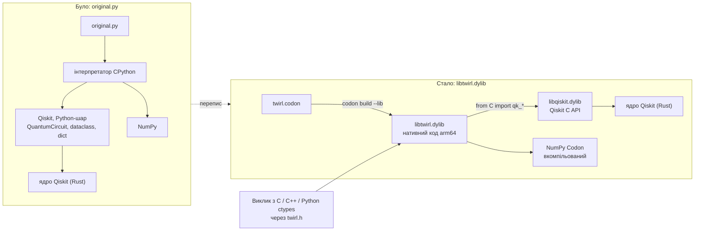

# Codon twirl

Measurement twirling з Python + Qiskit, перекомпільований у нативний машинний код через [Codon](https://github.com/exaloop/codon) і Qiskit C API.

## TL;DR

- **Що зроблено.** `original.py` (`preprocess` / `postprocess` для measurement twirling) переписано на Codon і зібрано в нативну бібліотеку `libtwirl.dylib` з C-інтерфейсом (`twirl.h`). Схеми будуються через Qiskit C API (`libqiskit`, ядро Qiskit на Rust), інтерпретатора Python у процесі немає.
- **Результат ідентичний.** 234 тестові випадки (випадкові схеми, усі стандартні гейти, широкі схеми до 63 кубітів, крайні значення) дають той самий вихід, що й `original.py`: кожна інструкція, фліпи й ймовірності.
- **Швидкість.** `preprocess` у 15–31 раз швидший за Python (−94…−97% часу), `postprocess` — у 17 разів. Для типових схем працює швидкий шлях без DAG, ще вдвічі швидший за першу версію; його можна вимкнути або ввімкнути режим перевірки.
- **Чому Codon.** Серед інструментів, що компілюють Python-подібний код, Codon — найкраща альтернатива: єдиний, що одразу дає `.dylib` без інтерпретатора Python, прямі виклики `libqiskit` і ті самі випадкові фліпи, що NumPy. Cython, mypyc, Nuitka, Numba та інші потребують CPython під час роботи. Порівнятися з Codon може лише переписування на Rust прямо поверх ядра Qiskit (рівнозначний за можливостями варіант — C/C++ через `qiskit.h`); деталі — `alternatives/report.md`.
- **Застереження.** Qiskit C API експериментальний; зібраний `libqiskit` поки залежить від libpython (Qiskit планує прибрати це у 2.7). Некінцеві вимірювання й символьні параметри повертають код помилки, хоча `original.py` їх приймає.

## Збірка і запуск

```bash
./build.sh                                   # libqiskit + libtwirl.dylib + тести у 3 режимах (Codon у ~/.codon)
SKIP_QISKIT=1 ./build.sh                     # без перезбірки libqiskit
python3 -m venv .venv && .venv/bin/pip install qiskit numpy
.venv/bin/python -I tests/gen_cases.py      # еталон з original.py
TWIRL_FAST_PATH=2 python3 -I tests/check_codon.py   # порівняння з libtwirl.dylib (0 off, 1 on, 2 verify)
```

## Перевірка і швидкість

Середній час `preprocess` на одну задачу (схема → 4 копії), мкс: загальний час виклику поділено на кількість задач. Медіана 50 запусків, 3 раунди, M1 Pro під навантаженням (load average ≈ 7–9); Codon — `perf/bench.c`, Python — `probe/bench_rfm.py [n T]`, та сама схема (H + ланцюжок CX + `measure_all`):

| Кубітів × задач у виклику | Codon, швидкий шлях (типово) | Codon, без швидкого шляху | Codon, перша версія | Python |
|---|---|---|---|---|
| 20 × 10 | 32–33 мкс | 63–65 мкс | 69 мкс | 615–638 мкс |
| 60 × 10 | 84–88 мкс | 171–175 мкс | 186–195 мкс | 2600–2650 мкс |
| 20 × 100 | 40–41 мкс | 67–69 мкс | 72–73 мкс | 616–627 мкс |

Codon швидший за Python у 15–31 раз (−94…−97% часу), швидкий шлях — приблизно вдвічі швидший за першу версію Codon (у 1,8–2,2 раза, −44…−55% часу); пораховано за серединами діапазонів.

**Швидкий шлях.** Перед твірлінгом треба прибрати зі схеми кінцеві вимірювання (`remove_final_measurements`). Загальний спосіб — перетворити схему на DAG (граф залежностей операцій), знайти в ньому кінцеві measure/barrier і зібрати схему заново; це «без швидкого шляху». Для типової схеми — спершу гейти, а вимірювання й бар'єри лише в самому кінці — граф не потрібен: кінець просто відрізається, решта переписується в тому ж порядку, що й у Qiskit. Це вдвічі швидше. Схеми іншої форми автоматично йдуть через DAG; деталі й захисти — у розділі «Швидкий шлях і його захисти» нижче.

У Python час на задачу не залежить від кількості задач у виклику (≈ 620 мкс при 10 і 100), у Codon при 100 задачах він вищий, ніж при 10 (40 проти 33 мкс; причину не перевіряли). `postprocess` на задачу (4 результати × 50 ключів): 5 мкс у Codon проти 83–87 мкс у Python (у 17 разів, −94% часу).

- `tests/gen_cases.py` генерує випадкові схеми й записує вхід і вихід `original.py` у `tests/cases.json` (234 випадки: усі стандартні гейти, широкі глибокі схеми, коди помилок, крайні значення); `tests/check_codon.py` проганяє ті самі входи через `libtwirl.dylib` і порівнює кожну інструкцію, фліпи й ймовірності. `build.sh` запускає його в усіх трьох режимах швидкого шляху; усі 234/234.
- Кожен захист перевірено навмисною поломкою (`tests/mutants/`, таблиця в `tests/README.md`).

## Про що проєкт

`original.py` реалізує **measurement twirling** — прийом зменшення помилок вимірювання на квантовому процесорі:

1. `preprocess` — для кожної схеми робить `k` копій, у кожній перед вимірюванням ставить X на випадкові кубіти й ділить shots між копіями.
2. Копії виконуються на квантовому процесорі.
3. `postprocess` — у результатах кожної копії перевертає ті самі біти назад і зливає копії в один розподіл ймовірностей.

Несиметричну помилку зчитування (наприклад, 1 частіше читається як 0) випадкові інверсії усереднюють.

**Мета:** отримати ці дві функції як нативну бібліотеку (`.dylib`), без інтерпретатора Python, і перевірити, що результат ідентичний.

> `preprocess` і `postprocess` працюють на класичному комп'ютері до відправки схеми й після отримання результатів, а не у вікні когерентності кубітів. Нативний код прискорює класичну частину, але на декогеренцію не впливає (докази — `research.md`, розділ 3).

## Як організовано перепис

Python-версія тягне за собою весь CPython і Python-шар Qiskit. Ядро Qiskit написане на Rust і має **C API** (`qiskit.h` + `libqiskit.dylib`). Порт викликає це ядро напряму, без Python:



Кроки:

1. **Qiskit C API.** `make c` у клоні Qiskit збирає `dist/c/lib/libqiskit.dylib` і `dist/c/include/qiskit.h` (потрібен Rust ≥ 1.91).
2. **Порт на Codon.** `twirl.codon` оголошує потрібні функції Qiskit через `from C import qk_circuit_gate(cobj, u8, Ptr[u32], Ptr[float]) -> u32` тощо й реалізує ту саму логіку.
3. **Компіляція.** `codon build -release --lib` компілює `twirl.codon` у `libtwirl.dylib` і лінкує її з `libqiskit`. Назовні — дві функції з C ABI: `twirl_preprocess` і `twirl_postprocess` (`@export`).
4. **Виклик.** Будь-яка програма підключає `twirl.h` і викликає ці функції; схеми передаються як `QkCircuit*`.

Чому не `from python import qiskit`: так Codon запускає Qiskit у вбудованому CPython — компілюється лише обгортка, прискорення немає.

## Що переписано


| У `original.py` | У `twirl.codon` |
|---|---|
| `QuantumCircuit` | `QkCircuit*` з Qiskit C API |
| `@dataclass Task` | `@tuple Task` (C-структура `TwirlTask`) |
| `@dataclass State` | аргументи `num_instances`, `seed` |
| `list[Task]` | вказівник + довжина |
| `context: dict` | масив `flips`, який виклик повертає в `postprocess` |
| `list[dict[str, int]]` (лічильники) | масиви `bits`, `counts`, `offsets` |
| бітовий рядок `"0101"` | `int64`, кубіт q = біт q |
| `remove_final_measurements` | порт `calc_final_ops` з Qiskit на DAG-функціях C API (у C API цієї функції немає) + швидкий шлях без DAG |
| `measure_all` | відтворено: регістр `meas`, бар'єр, `measure` q→q |
| `ValueError` | коди повернення (`twirl.h`) |
| `np.random.default_rng` | NumPy, вбудований у Codon (ті самі фліпи) |

Усередині функцій `list` і `dict` лишились — у Codon вони нативні; змінено лише те, що перетинає межу бібліотеки.

## Швидкий шлях і його захисти

Для типової схеми (гейти/reset, а в кінці лише measure/barrier) `twirl.codon` прибирає кінцеві вимірювання без побудови DAG — це вдвічі швидше. Будь-яка інша схема йде через порт на DAG. Перемикач: `twirl_set_fast_path(0 | 1 | 2)` — вимкнено / увімкнено (типово) / перевірка (рахує обидва шляхи, порівнює, при розбіжності бере DAG і збільшує `twirl_fast_path_mismatches()`).

| Ризик | Захист |
|---|---|
| Номери гейтів захардкоджені й зміняться в новій версії Qiskit | Таблиця «назва → номер» будується під час першого виклику з самої завантаженої `libqiskit`; X теж береться з неї |
| Підмінили `libqiskit` без перезбірки | `qk_api_version()` звіряється з версією `qiskit.h` на момент збірки (`qk_build.codon`), інакше код 8 |
| Порядок операцій має збігатися з `dag_to_circuit` Qiskit | Тести на широких глибоких схемах і всіх гейтах у режимах 1 і 2; `build.sh` проганяє їх після кожної збірки; режим 2 для перевірки в роботі |
| Символьний параметр (DAG-порт аварійно завершив би процес) | Перевірка `qk_param_kind` до обох шляхів, код 7 |
| Операція без кубітів (`global_phase`) | Такі схеми йдуть через DAG (знайдено тестом на всі гейти) |

## Обмеження

- Некінцеве вимірювання або операція, крім gate/barrier/reset → код 4 (`original.py` таку схему приймає).
- Символьні параметри гейтів → код 7 (`original.py` такі схеми приймає).
- До 63 кубітів (біти пакуються в `int64`).
- Qiskit C API позначений як експериментальний і може змінюватись між мінорними версіями.

Файли: `original.py` — еталон; `twirl.codon`, `twirl.h` — порт; `build.sh` — збірка; `research.md` — дослідження; `probe/` — драйвери й бенчмарки; `tests/` — тести еквівалентності.
