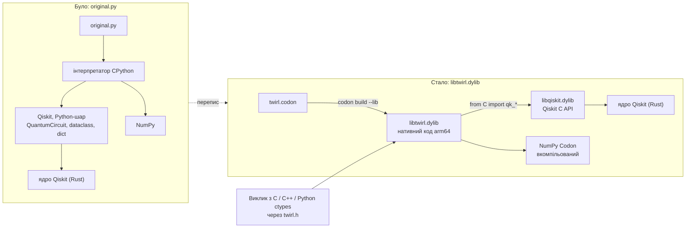
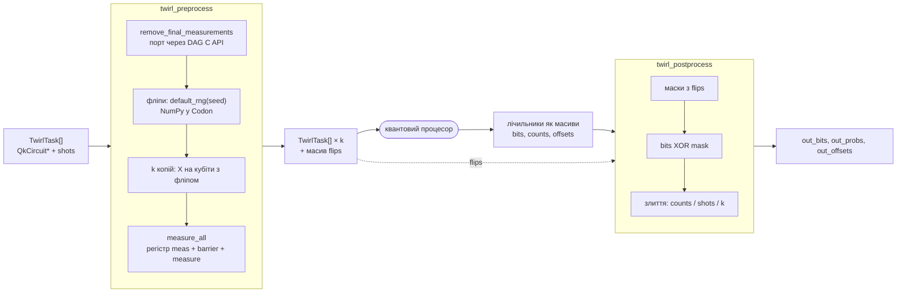

# Codon twirl

Measurement twirling з Python + Qiskit, перекомпільований у нативний машинний код через [Codon](https://github.com/exaloop/codon) і Qiskit C API.

## Про що проєкт

`original.py` реалізує **measurement twirling** — прийом зменшення помилок вимірювання на квантовому процесорі:

1. `preprocess` — для кожної схеми робить `k` копій, у кожній перед вимірюванням ставить X на випадкові кубіти й ділить shots між копіями.
2. Копії виконуються на квантовому процесорі.
3. `postprocess` — у результатах кожної копії перевертає ті самі біти назад і зливає копії в один розподіл ймовірностей.

Несиметричну помилку зчитування (наприклад, 1 частіше читається як 0) випадкові інверсії усереднюють.

**Мета:** отримати ці дві функції як нативну бібліотеку (`.dylib`), без інтерпретатора Python, і перевірити, що результат ідентичний.

> `preprocess` і `postprocess` працюють на класичному комп'ютері до відправки схеми й після отримання результатів, а не у вікні когерентності кубітів. Нативний код прискорює класичну частину, але на декогеренцію не впливає (докази — `research.md`, розділ 3).

## Як організовано перепис

Python-версія тягне за собою весь CPython і Python-шар Qiskit. Ядро Qiskit написане на Rust і має **C API** (`qiskit.h` + `libqiskit.dylib`). Порт викликає це ядро напряму, без Python:



Кроки:

1. **Qiskit C API.** `make c` у клоні Qiskit збирає `dist/c/lib/libqiskit.dylib` і `dist/c/include/qiskit.h` (потрібен Rust ≥ 1.91).
2. **Порт на Codon.** `twirl.codon` оголошує потрібні функції Qiskit через `from C import qk_circuit_gate(cobj, u8, Ptr[u32], Ptr[float]) -> u32` тощо й реалізує ту саму логіку.
3. **Компіляція.** `codon build -release --lib` компілює `twirl.codon` у `libtwirl.dylib` і лінкує її з `libqiskit`. Назовні — дві функції з C ABI: `twirl_preprocess` і `twirl_postprocess` (`@export`).
4. **Виклик.** Будь-яка програма підключає `twirl.h` і викликає ці функції; схеми передаються як `QkCircuit*`.

Чому не `from python import qiskit`: так Codon запускає Qiskit у вбудованому CPython — компілюється лише обгортка, прискорення немає.

## Що переписано



| У `original.py` | У `twirl.codon` |
|---|---|
| `QuantumCircuit` | `QkCircuit*` з Qiskit C API |
| `@dataclass Task` | `@tuple Task` (C-структура `TwirlTask`) |
| `@dataclass State` | аргументи `num_instances`, `seed` |
| `list[Task]` | вказівник + довжина |
| `context: dict` | масив `flips`, який виклик повертає в `postprocess` |
| `list[dict[str, int]]` (лічильники) | масиви `bits`, `counts`, `offsets` |
| бітовий рядок `"0101"` | `int64`, кубіт q = біт q |
| `remove_final_measurements` | порт `calc_final_ops` з Qiskit на DAG-функціях C API (у C API цієї функції немає) |
| `measure_all` | відтворено: регістр `meas`, бар'єр, `measure` q→q |
| `ValueError` | коди повернення (`twirl.h`) |
| `np.random.default_rng` | NumPy, вбудований у Codon (ті самі фліпи) |

Усередині функцій `list` і `dict` лишились — у Codon вони нативні; змінено лише те, що перетинає межу бібліотеки.

## Перевірка і швидкість

- `tests/gen_cases.py` генерує випадкові схеми й записує вхід і вихід `original.py` у `tests/cases.json`; `tests/check_codon.py` проганяє ті самі входи через `libtwirl.dylib` і порівнює кожну інструкцію, фліпи й ймовірності.
- Час (медіана 50 запусків, 10 задач × 4 копії × 20 кубітів, M1 Pro під навантаженням; `probe/bench_rfm.c`, `probe/bench_rfm.py`):

| | Codon | Python |
|---|---|---|
| `preprocess` | 0,70 мс | 6,33 мс |
| `postprocess` | 0,051 мс | 0,855 мс |

## Збірка і запуск

```bash
./build.sh                                   # libqiskit + libtwirl.dylib (Codon у ~/.codon)
python3 -m venv .venv && .venv/bin/pip install qiskit numpy
.venv/bin/python -I tests/gen_cases.py      # еталон з original.py
python3 -I tests/check_codon.py             # порівняння з libtwirl.dylib
```

## Обмеження

- Некінцеве вимірювання або операція, крім gate/barrier/reset → код 4 (`original.py` таку схему приймає).
- Символьні параметри гейтів не підтримуються (`libqiskit` панікує).
- До 63 кубітів (біти пакуються в `int64`).
- Qiskit C API позначений як експериментальний і може змінюватись між мінорними версіями.

Файли: `original.py` — еталон; `twirl.codon`, `twirl.h` — порт; `build.sh` — збірка; `research.md` — дослідження; `probe/` — драйвери й бенчмарки; `tests/` — тести еквівалентності.
